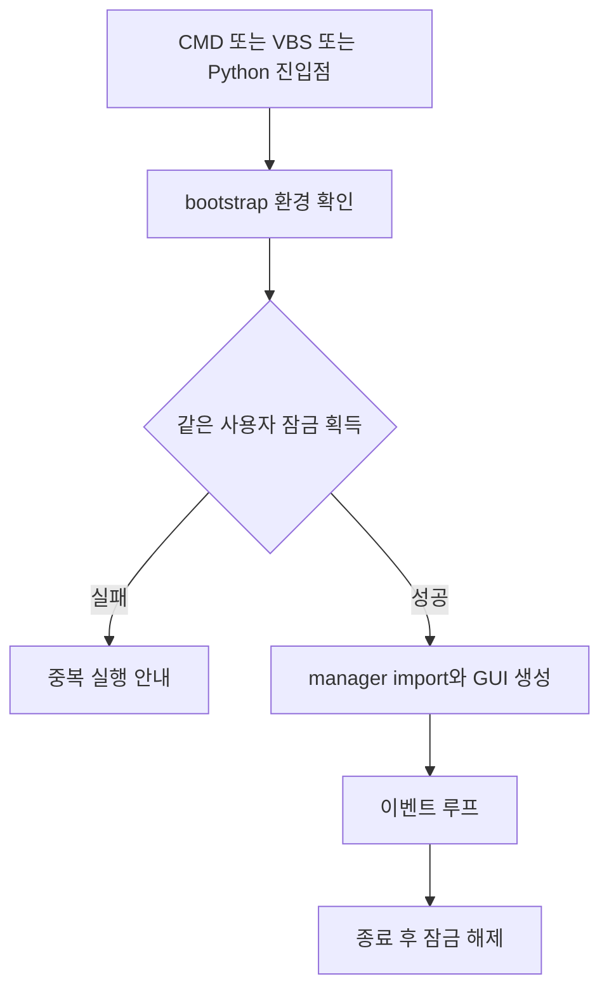

# 프로젝트 구조가 바뀐 과정

작성일: 2026-10-10. 현재 코드 기준: `38721e7`.

구조 변화의 목적은 파일 수를 늘리는 것이 아니었습니다. 사용자에게 보이는 순서, 실제 전송, 완료 확인과 복구 증거가 서로 어긋나지 않도록 책임을 나누는 것이었습니다. 세부 장애는 [오류와 해결](오류와_해결.md), 원본 기록과 검사 범위는 [근거와 검증](근거와_검증.md)에 있습니다.

## 1. 순차 대량 인쇄 프로그램에서 편집 가능한 큐로

**2026-05-24~27.** 처음에는 과목·회차·파일 범위·부수로 정해진 PDF를 순서대로 출력하는 프로그램이 목표였습니다. 곧 여러 주문을 쌓고 수정·이동·삭제하는 큐가 필요해졌습니다. 묶음별 반복 순서, 구분지, 인쇄 중 추가, 임의 PDF 드래그도 이 시기에 요청됐습니다.

이 단계에서 이미 중요한 동작 기준이 나왔습니다. 큐 순서가 실행 순서여야 하고, `전송 완료`와 `실제 인쇄 완료`는 구분해야 했습니다. 나중에 생긴 안전 요구만으로 보면 안 됩니다.

주요 UI와 자료 선택·작업 확장·전송 제어가 `unit_print_manager.py`를 중심으로 자랐습니다. 초기의 전체 Git 변경 이력이 현재 저장소에 모두 남아 있지는 않습니다. 이 시기의 설명은 원본 세션을 기준으로 하며, 존재하지 않는 과거 커밋을 만들어 연결하지 않았습니다.

## 2. 자료 종류와 드라이버 프로필이 늘어남

**2026년 6~7월.** 단원평가 외에 APEX, A:ble, 백지리뷰, OMR와 직접 PDF가 추가됐습니다. 모든 자료에 같은 인쇄 옵션을 적용할 수 없었습니다.

자료의 범위를 결정하는 카탈로그와 실제 출력 설정을 나누기 시작했습니다. 세로·가로·A:ble용 Windows 프린터 프로필을 구분했고, PDF 배치와 드라이버 배치의 책임을 정리했습니다. A:ble 2×2처럼 앱이 페이지를 조립하는 경우에는 드라이버에서 다시 4-up을 하지 않습니다.

현재 경계는 다음과 같습니다.

| 책임 | 현재 위치 |
|---|---|
| 시험 종류별 목록과 범위 | [unit_print_test_catalog.py](../../unit_print_test_catalog.py), `unit_print_catalog.json` |
| APEX·A:ble 등 자료와 페이지 조립 | [unit_print_materials.py](../../unit_print_materials.py) |
| 교평·기출엄선 | [unit_print_gyopyeong.py](../../unit_print_gyopyeong.py), [unit_print_selected_exams.py](../../unit_print_selected_exams.py) |
| 교과서 판본과 독립 페이지 범위 | [unit_print_textbooks.py](../../unit_print_textbooks.py), `unit_print_textbook_catalog.json` |
| 프린터 이름·프로필·설정 | [규칙](../../unit_print_printer_domain.py), [프로필](../../unit_print_printer_profiles.py), [설정 적용](../../unit_print_printer_setup.py) |
| PDF 검증·배치·Sumatra 설정 | [unit_print_pdf_printing.py](../../unit_print_pdf_printing.py) |
| 자료 루트와 이전 경로 호환 | [unit_print_paths.py](../../unit_print_paths.py) |

## 3. 서버와 로컬 인쇄기의 책임을 분리함

**2026-08-28.** 서버의 학생별 자료 배정을 로컬에서 다시 입력하는 작업을 줄이기 위해 대량 주문서 CSV를 연결했습니다.

서버는 자료 배정과 안정된 ID를 전달합니다. PDF 위치, 프린터 설정, 자동 OMR, 실제 인쇄 시작은 로컬 앱이 담당합니다. 서버 기능에 프린터 제어를 섞거나 CSV를 가져오는 즉시 인쇄하지 않습니다.

[unit_print_orders.py](../../unit_print_orders.py)는 CSV 파싱·검증을, [unit_print_server_catalog.py](../../unit_print_server_catalog.py)는 자료 ID 대응을 담당합니다. 모호한 파일명을 대충 맞추는 대신 정확한 ID와 상대 경로를 사용합니다. 일산기출의 서버 별칭도 해당 과목·시험 구분의 명시적 경로에 연결합니다. 이력에는 정규 자료 ID를 유지합니다.

## 4. 전송만 보던 구조에 장비의 증거를 추가함

**2026-09-05~19.** 영구 인쇄 이력을 넣고, 스테이플 부족과 실제 완료 문제를 계기로 Canon 연동을 추가했습니다. 파일 호출 성공, 장비 접수, 장비 완료와 오류 보류가 별도 상태가 됐습니다.

현재 장비 연동은 다음 책임으로 나뉩니다.

| 책임 | 현재 위치 | 유지할 기준 |
|---|---|---|
| 응답 데이터와 상태 모델 | [unit_print_device_state.py](../../unit_print_device_state.py) | 알 수 없는 상태를 정상으로 추정하지 않음 |
| Canon HTML·현재 상태·작업 목록 읽기 | [unit_print_canon_status.py](../../unit_print_canon_status.py) | 읽기 전용, 현재 값·렌더된 문구로 판정 |
| 상태 조회 주기와 스냅샷 | [unit_print_device_monitor.py](../../unit_print_device_monitor.py) | 빠른 접수 확인과 전체 상태 조회를 구분 |
| 작업 토큰·장비 대기 제어 | [unit_print_device_scheduler.py](../../unit_print_device_scheduler.py), [unit_print_dispatch_state.py](../../unit_print_dispatch_state.py) | 정확한 완료로만 전송 창을 보충 |
| Windows 대상과 Canon 동일성 | [unit_print_printer_binding.py](../../unit_print_printer_binding.py) | 승인한 TCP/IP 대상과 모니터 식별을 고정 |
| 선택적 인증값 보관 | [unit_print_device_credentials.py](../../unit_print_device_credentials.py) | Windows Credential Manager, 파일로 인증값 내보내지 않음 |
| 표시와 알림 | [unit_print_progress.py](../../unit_print_progress.py), [unit_print_notifications.py](../../unit_print_notifications.py), [unit_print_taskbar.py](../../unit_print_taskbar.py) | 오류·복구·완료의 전환만 알림 |

초기 장비 확인은 작은 문서의 처리 속도를 떨어뜨렸습니다. 이후 접수 목록을 빠르게 확인하는 경로와 전체 건강·잔량 조회를 분리했습니다. 기본 6건의 전송 창을 유지하되 매 작업 접수 확인은 남겼습니다. 성능과 순서 보호를 별도 비용으로 관리하도록 바뀐 것입니다.

## 5. 자료 범위를 카탈로그의 검증 대상으로 삼음

**2026-09-21~29.** 교과서 문제·해설·핵심문제와 변형이 추가됐습니다. UI의 단원 선택과 각 PDF 페이지 범위가 항상 같지는 않았습니다. 핵심문제의 대단원 평가, 변형의 번호 대응, 두 장의 표지도 함께 처리해야 했습니다.

그래서 페이지 범위를 단순한 파일명 추측으로 만들지 않고 판본별 메타데이터로 관리합니다. 문제·해설·핵심문제는 독립적으로 검증합니다. 표지 추가 후에는 기존 본문 범위를 두 페이지 이동합니다. 변형은 같은 단원 범위에 대응하며 표지 1~2페이지를 한 번 넣고 중복 본문 페이지를 제거합니다.

현재 42개 판본과 변형 15종은 이 구조를 사용합니다. 판본의 일부만 불명확해도 전체를 `pending`으로 둡니다. 전체 자료 배포·안전 복사는 파일의 크기·해시·필요한 페이지 수를 확인합니다. UI 선택 가능 여부와 실제 파일 무결성을 별도로 검증합니다.

## 6. 파일 삭제 사건 뒤 운영 데이터·자료·소스를 분리함

**2026-09-29~30.** 실행 파일과 과거 배포 폴더 누락을 조사하면서, 현재 정상 파일과 과거 전체 상태를 구별해야 했습니다. 같은 폴더에서 개발·자료·배포·운영 이력을 함께 다루면 정리 작업의 영향 범위가 커졌습니다.

현재 보관 경계는 다음과 같습니다.

| 종류 | 보관·전달 기준 |
|---|---|
| 코드·테스트·카탈로그·허용된 글꼴 | Git과 검증한 배포본 |
| 등록 인쇄물 PDF | 선택한 `<release_root>/data`, 전체 자료 Drive 채널 |
| 실제 PC 설정 | 로컬 설정 파일, Git·일반 배포 제외 |
| 학생·주문·전송 이력 | 앱의 로컬 `output` 이력, Git·일반 배포 제외 |
| 큐 백업·소비 영수증 | 세션별 로컬 복구 영역, Git·일반 배포 제외 |
| 페이지 수 캐시·시간 보정값 | 삭제 가능하거나 PC별인 로컬 캐시, 배포 제외 |
| PIN | Credential Manager, 설정·이력·로그에 쓰지 않음 |

안전 복사 도구는 완성된 새 자료 폴더만 공개합니다. 기존 자료를 자동으로 지우지 않습니다. 자료 이동은 내용 해시뿐 아니라 캐시가 쓰는 수정 시각도 보존합니다. 이 수정 시각 경계를 놓친 후속 GUI 장애가 실제 전체 생성자 검사 추가로 이어졌습니다.

Git는 검증된 현재 소스로 정상화했습니다. 유실 객체 7개는 복원했다고 주장하지 않습니다. 현재 공개 Git의 첫 기준은 9월 30일 검증 소스입니다. 5월부터의 모든 코드 diff가 Git에 남아 있는 것은 아닙니다.

## 7. 시작 진단과 같은 사용자 중복 실행 방지

지원하는 실행기는 [unit_print_bootstrap.py](../../unit_print_bootstrap.py)를 통해 manager를 불러옵니다. bootstrap은 표준 라이브러리로 환경을 확인하고 [unit_print_instance.py](../../unit_print_instance.py)의 Windows mutex를 얻습니다.

같은 Windows 사용자 SID의 Global mutex를 사용하므로 설치 폴더가 달라도 같은 사용자의 중복 앱을 막습니다. 다른 사용자·PC·외부 프로그램은 이 잠금의 대상이 아닙니다. 기존 pre-patch 프로세스를 강제로 보호하는 기능도 아닙니다.

필수 파일·패키지 확인은 전체 PDF 해시 검사가 아닙니다. 시작 오류는 학생·인증 정보가 섞일 수 있는 예외 원문과 지역 변수를 내보내지 않고 진단합니다. `StartupTrace`도 단계·시간·매핑 여부만 기록합니다.

## 8. 모델·실행·UI의 경계를 명시함

**2026-09-30 안정화.** 큰 manager에서 순수 모델과 실행 로직을 분리했습니다.

| 계층 | 현재 책임 | 의존 경계 |
|---|---|---|
| `unit_print_domain.py` | `ExamPdf`, `PrintBlock`, `PrintJob`, `PrintRunOptions`와 순수 이름·OMR·배치 규칙 | GUI 생성·파일 변경·Windows 프로세스 호출 없음 |
| `unit_print_execution.py` | `PrintExecutionMixin`, `build_print_jobs()`, 준비·전송·보류·재개·완료 | manager를 역으로 import하지 않음 |
| `PrintExecutionServices` | 외부 함수·경로·시간 제한을 명시적으로 전달 | 불변 서비스 묶음, 숨은 전역 조회를 줄임 |
| `unit_print_manager.py` | 활성 UI, 큐 편집, 선택 상태, 카탈로그 통합, 서비스 제공 | `PrintHistoryMixin`·`PrintExecutionMixin`과 상태를 공유하는 통합부 |

이 분리는 독립된 완전한 실행 엔진을 만들었다는 뜻은 아닙니다. 실행 mixin은 여전히 앱 상태와 콜백을 사용합니다. 다만 전송 루프를 읽고 검사할 파일이 분명해졌고, manager로 돌아가는 숨은 import 경로를 없앴습니다.

현재 핵심 흐름은 다음과 같습니다.

전송 기록과 장비 확인은 별도 증거입니다. UI 갱신은 UI 스레드에 전달합니다. PDF 준비가 늦게 끝나도 당시 선택의 결과를 현재 큐에 바로 반영하지 않습니다.

## 9. 큐의 상태·표시·복구를 나누고 불필요한 경로를 제거함

같은 시기에 사용하지 않는 UI 구현, 직렬 장비 전송 우회 경로, 실제 실행에서 쓰지 않는 상태 래퍼를 제거했습니다. 현재 활성 UI 빌더는 `build_ui_reset()` 하나입니다. 새 UI를 고칠 때 별도 참고용 구현을 복제하지 않습니다.

[unit_print_queue_state.py](../../unit_print_queue_state.py)는 대기·재시도·큐 스냅샷의 순수 판단을 맡습니다. [unit_print_queue_render.py](../../unit_print_queue_render.py)는 보이는 행의 범위를 계산합니다. manager의 선택 갱신은 모델 변경 기록과 분리했습니다. 화면 객체는 보이는 만큼만 만들지만 전체 큐의 스크롤·키보드 범위는 유지합니다.

큐 복구는 [unit_print_queue_recovery.py](../../unit_print_queue_recovery.py)와 [unit_print_recovery_history.py](../../unit_print_recovery_history.py)에 나눴습니다. 전자는 원자적 저장·잠금·영수증을, 후자는 내구성 있는 전송 증거와 전체 블록의 복구 자격을 다룹니다. 복구 증거는 기존 필수 `job_attempt`를 사용합니다. 복구를 위해 PDF마다 동기 디스크 저장을 하나 더 추가하지 않았습니다.

[unit_print_history.py](../../unit_print_history.py)는 일별 JSONL을 저장하고, [unit_print_history_events.py](../../unit_print_history_events.py)는 블록·작업·파일 해시의 이벤트 데이터를 만듭니다. 이력은 감사 기록입니다. 앱을 다시 열 때 자동 재인쇄할 목록으로 사용하지 않습니다.

## 10. 준비·미리보기·예측·표시를 독립적으로 관리함

**2026-10-07~09.** 사용자가 느끼는 지연과 화면 세부 동작을 다듬었습니다.

| 기능 | 분리한 책임 | 중요한 제한 |
|---|---|---|
| 준비 서비스 | [unit_print_preparation.py](../../unit_print_preparation.py)의 우선순위·반영 순서·취소 | 무제한 작업 예약 금지, 오래된 결과 버리기 |
| 시작 전 준비 | `unit_print_execution.py`의 준비 요청 스냅샷과 작업자 | UI 입력·큐 변경을 다시 검사한 뒤 시작 |
| 미리보기 | [unit_print_preview.py](../../unit_print_preview.py)와 background 갱신 | 실패 시 active·poll 상태 해제, 자동 무한 재시도 금지 |
| 페이지 수 | [unit_print_pdf_metadata.py](../../unit_print_pdf_metadata.py) | 서명 확인·최대 512개, 실제 사전 검사 대체 금지 |
| A4·스테이플 예상 | [unit_print_resource_estimate.py](../../unit_print_resource_estimate.py) | 센서 구간을 정확한 장수처럼 표시하지 않음 |
| 완료 시각 | [unit_print_eta.py](../../unit_print_eta.py) | 대기와 처리 시간 구분, 외부·보류 구간 제외 |
| 탐색기 열기 | [unit_print_source_paths.py](../../unit_print_source_paths.py) | 등록 원본 선택, 폴더 중복 제거, 인쇄 상태 변경 없음 |
| 화면 토큰 | [unit_print_theme.py](../../unit_print_theme.py) | 인쇄 로직 없음, 기존 프레임워크 유지 |
| 한국어 표시 | [unit_print_typography.py](../../unit_print_typography.py) | 표시 값만 줄바꿈, 원문·입력·한 줄 큐 유지 |
| 키보드 | [unit_print_keyboard.py](../../unit_print_keyboard.py), [unit_print_text_shortcuts.py](../../unit_print_text_shortcuts.py) | 텍스트와 큐의 선택·undo 범위를 분리 |

선택 블록 자동저장은 manager의 편집 통합부에 남아 있습니다. 별도 입력 패널을 추가한 것이 아니라, 초안을 벗어나는 모든 경로가 같은 검증·저장 절차를 거치도록 연결했습니다.

## 11. 공개 소스와 전체 자료 배포를 구분함

**2026-10-10.** 코드와 설치·수정 근거는 공개 Git에 올리고, 대용량 인쇄물은 하나의 Drive 폴더로 전달하도록 했습니다.

이 방식에서 Git 최신 코드와 Drive 배포본의 코드 시점이 다를 수 있습니다. 현재 설치는 Git 코드를 기준으로 하고 Drive에서 `data`만 연결합니다. 이전 패키지의 코드나 manifest를 최신 소스 위에 덮어쓰지 않습니다. 자료 업데이트는 기본 PDF와 추가 파일의 해시를 확인하며 불필요한 삭제를 자동으로 하지 않습니다.

글꼴도 재현 대상입니다. 현재 배포는 Pretendard 네 TTF와 OFL 고지를 포함하고 설치한 실제 글꼴과 Tk 선택을 확인합니다. 상용 글꼴을 임의로 복사하거나 다른 글꼴 충돌을 자동으로 덮어쓰지 않습니다. 설치·전체 자료 경로는 [저장소 README](../../README.md)를 기준으로 합니다.

## 현재 구조의 성과와 남은 문제

버전이 확인되는 manager를 같은 방식으로 계산했습니다. 행 수는 파일 전체, 메서드 수는 `PrintManagerApp`에 직접 정의한 함수 수입니다. 날짜가 같은 여러 단계의 기준이므로 시계를 거슬러 초기 전체 역사를 추정하지 않습니다.

| Git 기준 | manager 행 수 | 앱 메서드 수 | 의미 |
|---|---:|---:|---|
| [fce642d](https://github.com/HDHhhdhh/HDHprinter/commit/fce642d) | 15,738 | 502 | 9월 30일 안정화 전 검증 소스 |
| [880c62f](https://github.com/HDHhhdhh/HDHprinter/commit/880c62f) | 14,232 | 490 | 시작·자료·도메인·실행 경계 안정화 |
| [2a64784](https://github.com/HDHhhdhh/HDHprinter/commit/2a64784) | 14,238 | 490 | 실제 GUI 시작 지연 수정 |
| [38721e7](https://github.com/HDHhhdhh/HDHprinter/commit/38721e7) | 14,833 | 517 | 10월 9일까지의 UX·성능·표시 패치 반영 |

분리 뒤에도 manager는 큽니다. 행 수 감소 자체가 속도나 오류 감소의 증거는 아닙니다. 후속 기능과 안전 검사가 늘면서 통합부도 다시 커졌습니다. 현재의 장점은 순수 규칙, 실행, 저장 증거와 화면 도우미의 책임이 더 분명해졌다는 점입니다. 실제 실행 경계를 검사할 테스트도 생겼습니다.

남은 구조 개선 후보는 다음과 같습니다. 이번 문서 작업에서 구현하지는 않았습니다.

- **큐 편집 명령 분리:** 추가·삭제·정렬·붙여넣기·자동저장의 준비와 검증을 공통 명령 경계로 모을 수 있습니다. UI 선택, 이력 ID, 상태 키를 먼저 명세해야 합니다.
- **카탈로그 UI 조립 분리:** 종류별 위젯과 범위 갱신을 분리할 수 있습니다. 새로운 공통화가 자료별 예외를 숨기지 않도록 해야 합니다.
- **실행 상태 의존 축소:** mixin이 사용하는 앱 필드를 명시적 상태로 줄일 여지가 있습니다. 이미 안정된 전송 실패 경계를 대규모 재작성으로 바꾸기 전에 생산 경로의 검사를 유지해야 합니다.
- **실측 성능 관리:** 사용자 조작별 지연과 실제 처리량은 직접 측정해야 합니다. 합성 객체 수 감소를 처리량 개선율로 쓰지 않습니다.
- **ETA 품질 관리:** 작업 종류·추가·삭제·보류 여부와 함께 예측 오차를 관측해야 합니다. 한 작업의 사후 재계산으로 전체 성능을 선언하지 않습니다.

다음 리팩토링은 이 경계를 더 분명하게 만드는 작업이어야 합니다. 새로운 추상화가 실제 사용 경로를 줄이고 검사 범위를 설명할 수 있을 때 도입합니다.
