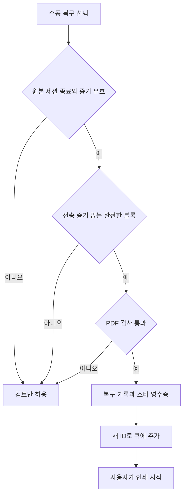

# 공을 많이 들인 오류와 해결

작성일: 2026-10-10. 이 문서는 사용자 세션, 당시 장애 보고서, 현재 코드와 테스트를 대조한 기록입니다. 검사 결과의 날짜와 방법은 [근거와 검증](근거와_검증.md)에 모았습니다. 현재 동작은 [제품 동작 정본](../../빠른인쇄기_제품동작_정본.md)을 우선합니다.

원인을 확인한 사례와 가능성만 좁힌 사례를 구분했습니다. 모든 사례를 실물 인쇄로 재검증했다는 뜻은 아닙니다.

| 번호 | 주요 상황 | 다시 지켜야 할 경계 |
|---|---|---|
| E01 | 앱 실행 환경이 달라 드래그 기능 또는 GUI가 실패 | 설치에 쓴 Python과 실행 Python |
| E02 | 방향·축소·양면·스테이플 위치가 예상과 다름 | PDF 배치와 프린터 드라이버 설정 |
| E03 | 첫 탭에 다른 교재 목록이 나타남 | 카탈로그와 탭별 선택 상태 |
| E04 | ping은 되지만 인쇄가 안 됨 | 네트워크 도달과 실제 인쇄 대상 |
| E05 | 스테이플 부족을 놓치고 재개 후 순서가 섞임 | 앱 전송, 장비 접수, 물리적 완료 |
| E06 | 이미 출력됐는데 진행 중에서 바뀌지 않음 | Canon 응답 파싱과 완료 증거 |
| E07 | 안전 패치 뒤 작은 문서 사이에 프린터가 쉼 | 빠른 접수 확인과 느린 전체 상태 조회 |
| E08 | A4 카세트 하나만 비어도 멈춤 | 용지 경고와 실제 대체 급지 가능 여부 |
| E09 | 용지 보충을 위한 카세트 열림이 오류가 됨 | 실물 검증한 열림 코드와 다른 오류 |
| E10 | 예약 블록 삭제 후 이름 구분지가 사라짐 | 최신 큐와 미전송 작업 목록 |
| E11 | 묶기 명령이 하나의 병합 PDF를 만듦 | 큐 묶음과 차시별 자료 조립 |
| E12 | 파일 삭제 사건과 작업 큐 손실 | 현재 운영 복구와 과거 전체 복원 |
| E13 | 자료 통합 뒤 GUI가 보이지 않음 | 파일 내용과 캐시용 수정 시각 |
| E14 | 전송 뒤 기록 실패가 중복 인쇄로 이어질 위험 | 전송 확정·불확실·미전송 |
| E15 | 큰 큐에서 선택과 화면 반응이 느림 | 화면 갱신과 모델·파일 작업 |
| E16 | 완료 시간이 실제보다 크게 늦게 예측됨 | 큐 대기 시간과 장비 처리 시간 |
| E17 | 입력·단축키·줄바꿈 패치가 기존 UX를 침범 | 편집 초안, 입력 포커스, 표시용 문자열 |

## E01. 설치한 환경과 실행 환경이 달랐음

**기록:** 2026-05-27의 다중 PDF 드래그 작업에서 `tkinterdnd2`가 없다는 오류가 발생했습니다. 패키지를 설치한 Python과 런처가 선택한 Python이 달랐습니다. 당시 `pyw -3`는 Python 3.14 시험 버전을 선택했고, 패키지는 3.12 쪽에 있었습니다.

**해결:** 런처의 Python 선택을 정리했습니다. 이후 실행 경로는 bootstrap을 거치도록 통합했습니다. 현재 설치·실행 안내는 Python 3.12와 앱 가상환경을 사용합니다. 시작 전에는 필요한 파일과 패키지를 확인합니다. 시작 실패 시에는 안내와 진단 기록을 남깁니다.

**확인과 한계:** 런처 분기 검사, 환경 검사, 실제 생성자 검사는 서로 다른 역할입니다. 런처 스텁 검사만으로 특정 PC의 GUI가 열린다고 판단하지 않습니다. 2026-10-09에는 해당 환경의 VBS 실행 검사에 시간 초과가 있었고, 이는 미확인으로 남겼습니다.

**현재 근거:** [bootstrap](../../unit_print_bootstrap.py), [환경 검사](../../scripts/verify_quick_printer_environment.py), [시작 검사](../../tests/test_unit_print_bootstrap.py), [런처·설치 검사](../../tests/test_unit_print_launch_install.py).

## E02. 인쇄 방향과 마감 설정이 자료 종류마다 달랐음

**기록:** 2026년 6~7월에는 가로 문서 축소, 스테이플 위치, 양면 뒤집기 방향, A:ble의 2×2 인쇄가 반복해서 논의됐습니다. 한 프린터에서 출력하더라도 자료 종류별 요구가 달랐습니다. PDF 회전값, 앱의 배치 처리, 드라이버의 배치 처리를 함께 보아야 했습니다.

**해결:** 자료의 방향과 프린터 프로필을 분리했습니다. 세로 문서는 긴 변 양면, 가로 문서는 짧은 변 양면을 기준으로 합니다. 일반 자료는 위쪽 왼쪽 스테이플, 구분지는 스테이플 없음이 기준입니다. A:ble의 2×2는 앱에서 페이지를 조립하고 드라이버에는 1-up으로 보냅니다. 두 곳에서 동시에 4-up을 적용하지 않습니다.

**확인과 한계:** 당시 기록에는 PDF 페이지 검사와 전송·큐 관측이 있습니다. 16페이지를 2×2로 만든 결과는 4페이지이며, 양면 출력은 2장입니다. 이 계산과 Windows 큐 관측은 실물의 스테이플 위치까지 증명하지 않습니다. 드라이버 변경 후에는 실제 출력물의 방향과 마감을 별도로 확인해야 합니다.

**현재 근거:** [프린터 규칙](../../unit_print_printer_domain.py), [프로필](../../unit_print_printer_profiles.py), [설정 적용](../../unit_print_printer_setup.py), [PDF 처리](../../unit_print_pdf_printing.py), [4-up 검사](../../tests/test_unit_print_four_up.py), [Sumatra 설정 검사](../../tests/test_unit_print_sumatra_settings.py).

## E03. 다른 탭의 카탈로그가 첫 화면에 섞였음

**기록:** 2026-08-09에는 단원평가 탭에 APEX 변경 내용이 영향을 준 문제가 있었습니다. 초기 선택과 목록 갱신이 서로 간섭한 사례입니다. 같은 날에는 차시를 숫자만으로 표시하지 말고 실제 차시명을 사용하라는 요청도 있었습니다.

**해결:** 시작 위치는 `테스트 > 단원평가`로 유지합니다. 단원평가, 다른 시험, 교재, 교과서는 각각의 카탈로그와 범위 규칙을 사용합니다. 교재 기능을 추가하면서 시험 카탈로그의 기준을 바꾸면 안 됩니다.

**확인과 한계:** 초기 선택과 카탈로그 검사는 실제 앱 생성자 검사와 함께 보아야 합니다. 자료 수는 시점과 집계 대상에 따라 달라집니다. 과거의 단원평가 파일 수를 현재 전체 서버 자료 ID 수와 직접 비교하면 안 됩니다.

**현재 근거:** [UI 통합부](../../unit_print_manager.py)의 `build_ui_reset()`, [시험 카탈로그](../../unit_print_test_catalog.py), [교재 카탈로그](../../unit_print_materials.py), [실제 생성자 검사](../../tests/test_unit_print_startup_constructor.py), [카탈로그 검사](../../tests/test_unit_print_test_catalog.py).

## E04. ping 성공이 인쇄 연결 성공은 아니었음

**기록:** 2026-08-14의 별도 PC 네트워크 인쇄 세션에서는 ping이 응답했지만 RAW 인쇄 포트 연결이 실패했습니다. 프린터 IP가 보인다는 사실만으로 Windows 큐와 실제 인쇄 경로가 정상이라고 볼 수 없었습니다.

**해결:** IP 도달, TCP 인쇄 포트, Windows 포트 설정, 드라이버와 부서 인증을 구분해서 조사하도록 했습니다. 이후 Canon 상태 연동에는 더 강한 대상 검증을 넣었습니다. 시작·재시도·인쇄 중 추가 전에 본문, 이름 구분지, OMR의 실제 Windows 대상이 같은 Canon의 Standard TCP/IP 포트인지 확인합니다.

**확인과 한계:** 8월 세션은 진단과 대응 지시 기록입니다. 그 PC의 최종 정상 출력을 확인한 기록으로 해석하지 않습니다. 현재 대상 검증은 WSD·USB·공유·알 수 없는 포트로 같은 장비임을 추정하지 않습니다. 한 실행 중 외부에서 포트 설정을 바꾸는 경우를 계속 감시하는 기능도 아닙니다.

**현재 근거:** [프린터 대상 검증](../../unit_print_printer_binding.py), [규칙 검사](../../tests/test_unit_print_printer_binding.py), [실행 경계 검사](../../tests/test_unit_print_printer_binding_workflow.py).

## E05. 스테이플이 떨어져 멈췄는데 앱에서는 알아차리기 어려웠음

**기록:** 2026-09-18에 사용자는 스테이플 부족으로 멈춘 사실을 늦게 알았습니다. 보충 후에는 출력 순서도 큐와 달랐다고 보고했습니다. 앞선 5월에도 `전송 완료 / 인쇄 중`과 `전송 완료 / 인쇄 완료`를 나눠 달라는 요청이 있었습니다.

**원인 범위:** Windows 큐 개수와 전송 성공만 보던 방식은 장비의 소모품 오류와 실제 출력 상태를 충분히 설명하지 못했습니다. 서로 다른 Windows 프린터 큐가 같은 Canon으로 들어가는 구조도 고려해야 했습니다. 당시 앱 전송 순서가 뒤집혔다는 증거는 확인되지 않았습니다. 과거 장비 작업 로그가 부족하므로 출력이 섞인 정확한 원인을 하나로 확정하지는 못했습니다.

**해결:** Canon Remote UI를 읽는 경로를 추가했습니다. 전송 파일에 작업 토큰을 부여하고, 장비의 활성 목록이나 작업 로그에서 접수를 확인한 뒤 다음 파일을 보냅니다. 오류 시 새 전송을 멈추고 이미 제출한 토큰을 보관합니다. 재개 전에는 이 토큰을 다시 대조합니다. 오류 팝업과 작업표시줄 표시는 사용자가 놓치지 않도록 유지합니다. 알림은 상태 전환 때만 발생하도록 중복을 줄였습니다.

**확인과 한계:** 모의 장비 검사는 실제 전송 루프의 순서·보류·재개를 검사합니다. 같은 Windows 사용자의 중복 앱은 mutex가 막습니다. 다른 사용자, 다른 PC, 다른 인쇄 프로그램까지 전역으로 직렬화하는 것은 아닙니다. 외부 작업이 존재하는 환경에서 이 앱만으로 모든 출력의 전체 순서를 보장하지 않습니다.

**현재 근거:** [Canon 읽기](../../unit_print_canon_status.py), [모니터](../../unit_print_device_monitor.py), [전송 창](../../unit_print_device_scheduler.py), [실행 루프](../../unit_print_execution.py), [진행 상태](../../unit_print_progress.py), [알림](../../unit_print_notifications.py), [실행 흐름 검사](../../tests/test_unit_print_dispatch_workflow.py).

## E06. 종이는 출력됐지만 블록은 계속 진행 중이었음

**기록:** 2026-09-18의 후속 점검에서 사용자는 평소라면 끝났을 작업이 계속 진행 중이라고 보고했습니다. 장비에는 완료한 작업이 있었지만 앱이 완료 증거를 읽지 못했습니다.

**원인:** Canon 작업 페이지는 탐색 초기화가 필요했습니다. `/sysmonitor` 경로의 초기화와 동적으로 만들어지는 표 머리글을 고려하지 않은 파싱이 완료 행 해석을 방해했습니다. 세션이 만료되면 로그인 페이지가 반환될 수도 있었습니다.

**해결:** 작업 페이지 초기화, 로그인 판별, 표 머리글과 대체 해석을 보완했습니다. 접수 번호·토큰과 작업 결과를 대조합니다. 상태 판정에서는 전체 JavaScript 본문을 오류 문장으로 검색하지 않습니다. 스크립트에는 현재 발생하지 않은 모든 상태 문구도 들어 있기 때문입니다. 현재 `prt_status`·`errCodeTbl` 값과 렌더된 문구를 사용합니다.

**확인과 한계:** 당시 장비 완료 결과를 읽은 뒤 같은 작업을 다시 인쇄하지 않도록 안내했습니다. 완료 팝업은 장비 연동 시 실제 장비 완료 확인을 따라야 합니다. 장비의 완료 결과는 출력 품질을 사람이 검사했다는 뜻까지 포함하지 않습니다. 장비 연동이 없을 때는 Windows 큐 기준을 별도로 유지합니다.

**현재 근거:** [상태·작업 파서](../../unit_print_canon_status.py)의 `parse_health_html()`·`parse_jobs_html()`·`CanonStatusClient`, [장비 상태 검사](../../tests/test_unit_print_device_status.py), [완료 알림 검사](../../tests/test_unit_print_notifications.py).

## E07. 오류 방지 후 프린터의 쉬는 시간이 늘었음

**기록:** 2026-09-19에 이름 구분지와 OMR 같은 작은 문서 사이에 프린터가 쉬는 현상이 보고됐습니다. 내부 3건 설정이어도 장비의 대기 문서는 0~2건이었습니다. 사용자는 이전보다 체감 속도가 거의 두 배 느려졌다고 설명했습니다.

**원인:** 순서 보호를 위한 확인에 장비의 전체 상태 조회가 결합돼 있었습니다. 당시 보고된 전체 조회는 약 3초를 사용했습니다. 작은 문서에서는 출력 시간보다 이 확인 비용이 더 크게 느껴질 수 있었습니다.

**해결:** 빠른 활성 작업·토큰 접수 확인과 전체 상태 조회의 주기를 분리했습니다. 기본 전송 창은 6건이며, 1~10건으로 조절할 수 있습니다. 한 작업이 장비에 접수된 증거를 얻은 뒤 다음 작업을 보냅니다. 정확한 장비 완료가 한 건 확인되면 빈 자리를 채웁니다. 건강 상태, 용지와 완료의 전체 조회는 별도 주기로 계속 수행합니다. PDF 준비는 제한된 선행 작업으로 처리합니다.

**확인과 한계:** 전송 창 6건과 준비 서비스의 다음 두 작업 미리 준비는 서로 다른 설정입니다. 보류 상태에서는 빈 자리가 생겨도 보충하지 않습니다. 모의 검사 통과나 상태 조회 감소를 실물 처리량 두 배 개선으로 환산하지 않습니다. 현재 구조는 정확한 장비 접수 확인을 생략해서 속도를 높이는 방식이 아닙니다.

**현재 근거:** [전송 스케줄러](../../unit_print_device_scheduler.py), [실행 루프](../../unit_print_execution.py)의 `print_blocks_device_rolling()`, [준비 서비스](../../unit_print_preparation.py), [전송 흐름 검사](../../tests/test_unit_print_dispatch_workflow.py), [준비 검사](../../tests/test_unit_print_preparation.py).

## E08. A4 카세트 하나가 비었는데 다시 멈췄음

**기록:** 2026-09-20에 한 카세트가 비어도 다른 카세트로 인쇄할 수 있다는 요청이 있었습니다. 첫 수정 후에도 9월 27일 실제 장비에서 다시 멈췄습니다.

**원인:** 일반 용지 부족 상태의 처리만으로 실제 장비가 보내는 오류 코드를 충분히 다루지 못했습니다. 후속 관측에서는 `errCodeTbl`의 `0x1060202`, `prt_status=0x20`, 카세트 하나의 0%와 다른 카세트의 66~100%가 함께 확인됐습니다.

**해결:** 확인한 코드만 A4 용지 경고로 분류했습니다. `reconcile_a4_paper_health()`는 알려진 A4 급지원을 다시 대조합니다. 다른 카세트에 양수의 잔량 구간이 있으면 그 용지 경고만으로 전송을 막지 않습니다. 둘 다 비었으면 보류합니다. 알 수 없는 값은 충분한 용지의 증거로 사용하지 않습니다. 다른 오류 코드나 상태 비트가 함께 있으면 계속 막습니다.

**확인과 한계:** 이 수정의 중요한 근거는 실제 장비 응답입니다. 첫 회귀 검사가 통과했어도 이 응답을 검사하지 않았다면 같은 문제가 재발할 수 있습니다. 센서는 정확한 남은 장수를 주지 않습니다. 66~100%를 정확한 수량으로 표시하면 안 됩니다. 이 예외를 모든 Canon 모델의 모든 용지 오류에 일반화하지 않습니다.

**현재 근거:** [Canon 상태 조정](../../unit_print_canon_status.py)의 `_A4_PAPER_WARNING_CODES`·`reconcile_a4_paper_health()`, [장비 상태 검사](../../tests/test_unit_print_device_status.py), [잔량·예상 자원 검사](../../tests/test_unit_print_resource_estimate.py).

## E09. 종이를 보충하려고 카세트를 열면 오류처럼 보였음

**기록:** 2026-10-01에 용지 보충 동작을 오류에서 제외해 달라는 요청이 있었습니다. 사용자는 용지 걸림과 구별할 수 없다면 패치를 취소하겠다고 했습니다. 이후 전용 코드를 실제 카세트 열림과 비교하기 위해 직접 도왔습니다.

**확인:** 카세트 1·2의 열림과 닫힘을 대조했습니다. 확인한 코드는 `0x01180102`, `0x01180202`이며 상태 값은 `0x20`·`0x21`이었습니다. 다른 카세트를 연 상태에서 시험 문서 한 장이 출력됐다는 사용자 확인도 받았습니다.

**해결:** 검증한 두 코드만 용지 보충 상태로 처리합니다. 다른 카세트가 닫혀 있고, A4 급지원으로 식별되며, 양수의 잔량 구간이 확인될 때만 계속 보냅니다. 열린 카세트의 0%는 용지 소진 증거로 사용하지 않습니다. 둘 다 열렸거나 대체 공급이 불명확하면 보류합니다. 혼합 코드, 알 수 없는 코드, 별도 오류 문구와 다른 차단 비트는 오류로 유지합니다.

**확인과 한계:** 이 사례는 모의 파서 검사와 사용자의 실물 관측을 함께 사용했습니다. 일부 전용 코드의 검증이지 용지 보충 중 모든 오류를 무시하는 기능이 아닙니다. 다른 급지 위치나 다른 펌웨어의 유사 코드를 추측해서 추가하지 않습니다. 장비 접수·완료 확인도 그대로 유지합니다.

**현재 근거:** [열림 상태 조정](../../unit_print_canon_status.py)의 `_CASSETTE_OPEN_CODES`·`_reconcile_cassette_open_health()`, [상태 검사](../../tests/test_unit_print_device_status.py), [전송 검사](../../tests/test_unit_print_dispatch_workflow.py). 실물 검증의 공개 요약은 [근거와 검증](근거와_검증.md)에 있습니다.

## E10. 예약 블록 삭제가 남은 이름 구분지에 영향을 줬음

**기록:** 2026-09-19 이후 인쇄 중 `예약` 블록 삭제를 허용했습니다. 이 변경은 삭제 버튼의 활성 여부만 바꾸면 끝나는 작업이 아니었습니다.

**원인:** 같은 학생의 연속 블록은 하나의 이름 구분지를 공유할 수 있습니다. 첫 블록을 지우면 구분지의 소유 블록도 사라집니다. 이미 만든 작업 목록이 삭제 전의 큐를 계속 사용하면 지운 블록이 인쇄되거나 남은 자료에서 구분지가 빠질 수 있습니다.

**해결:** 아직 시작하지 않은 블록만 삭제할 수 있게 했습니다. 남은 미전송 이름 그룹의 구분지를 다시 계산하고, 전송 직전에는 최신 큐에 작업이 유효하게 남아 있는지 확인합니다. 시작·제출한 블록은 보호합니다. 큐의 undo로 실제 제출한 문서를 미전송으로 되돌리지 않습니다.

**확인과 한계:** 블록 객체 교체 시 UI 상태의 `id(block)` 키와 이력용 UUID를 함께 다뤄야 합니다. UUID만 같게 보존하거나 화면 순서만 고치는 방식은 충분하지 않습니다.

**현재 근거:** [큐 상태](../../unit_print_queue_state.py), [재시도](../../unit_print_retry.py), [이름 그룹 규칙](../../unit_print_domain.py), [큐 생명주기 검사](../../tests/test_unit_print_queue_lifecycle.py), [이름 채우기 검사](../../tests/test_unit_print_queue_name_fill.py).

## E11. 묶음의 정의가 구현 과정에서 바뀌었음

**기록:** 원래 2026-05-24에 정한 묶음은 파일 순서 반복이었습니다. 10월 1일 사용자는 우클릭 묶기가 파일들을 병합해서 한꺼번에 인쇄한다고 지적했습니다.

**원인:** 큐 블록을 하나로 표현하는 것과 PDF 페이지를 하나로 병합하는 것을 같은 기능으로 해석했습니다. A:ble/APEX의 차시별 병합과도 의미가 섞였습니다.

**해결:** 큐 묶음은 원본 `ExamPdf` 참조를 순서대로 보존합니다. 다섯 개 한 파일 블록을 5부씩 묶으면 `[1,2,3,4,5] × 5`, 총 25개 작업이 됩니다. 파일별 스테이플 설정도 유지합니다. 부수·이름·실제 프린터·배치·방향이 다른 선택은 함께 묶지 않습니다. 준비가 끝난 뒤에도 블록 객체, 입력값, 위치와 상태가 그대로인지 확인합니다.

**확인과 한계:** 현재 검사에는 원본 파일 순서, 중복 경로, 25개 작업, 새 병합 파일을 만들지 않는 조건이 있습니다. 이미 과거 구현으로 병합한 한 파일 블록은 자동으로 원본 다섯 파일로 복원하지 않습니다. 원본 블록을 다시 선택해서 만들어야 합니다. 이미 제출한 작업도 자동으로 바꾸거나 재인쇄하지 않습니다. A:ble/APEX 차시 병합은 별도 승인된 규칙으로 남습니다.

**현재 근거:** [큐 묶음 통합부](../../unit_print_manager.py)의 `make_queue_bundle_block()`, [별도 차시 자료 조립](../../unit_print_materials.py), [작업 모델](../../unit_print_domain.py), [실제 큐 묶음 검사](../../tests/test_unit_print_queue_bundle.py), [준비 결과 반영 검사](../../tests/test_unit_print_group_preparation.py).

## E12. 파일 삭제 사건과 중단된 큐를 같은 문제로 취급하면 안 됐음

**기록:** 2026-09-29~30에는 실행에 필요한 모듈과 과거 배포 폴더의 파일이 없어지는 상황이 있었습니다. 사용자는 별도 정리 작업을 중단했다고 답했습니다. 앱 중단 전의 큐를 되살릴 수 있는지도 반복해서 물었습니다.

**확인한 범위:** 현재 운영에 필요한 코드와 자료를 대조했습니다. 등록 PDF 1,852개와 교과서 141개·42판본을 검증하고 자료 루트를 통합했습니다. 기존 `.git`의 HEAD·config·index가 없었고, 과거 참조 객체 7개가 실제로 유실돼 있었습니다. 앱의 삭제 경로 감사만으로 외부 삭제 원인을 확정한 것은 아닙니다.

**운영 파일의 해결:** 원본과 기존 대상을 보존한 채 새 staging 폴더에 복사했습니다. 크기·SHA-256·필요한 페이지 수를 확인한 완성 폴더만 공개했습니다. 작업 폴더와 떨어진 백업을 만들었습니다. 정상 객체와 검증한 소스로 Git 기준을 재구성했고 무결성 검사를 통과했습니다.

**큐 손실의 해결:** 세션별 큐 메타데이터를 원자적으로 저장합니다. 빈 새 세션이 이전 백업을 덮어쓰지 않습니다. 복구 시에는 원본 세션이 사용 중인지, 최신 이력에 전송 증거가 있는지, 이미 복구에 소비됐는지 확인합니다. 복구 기록과 소비 영수증을 남긴 뒤 새 블록으로 반영합니다. 파일은 복구 전에 다시 검사합니다.

복구 절차는 자동 인쇄를 포함하지 않습니다. 기록·파일·잠금·영수증 중 필요한 증거가 없으면 복구를 막습니다.

**확인과 한계:** 현재 필요한 파일 복구와 삭제 직전 전체 상태 복원은 다릅니다. 유실된 Git 객체 전체를 복구하지 못했습니다. 복구 기능이 없던 시점의 메모리 큐를 새 기능으로 소급 복원할 수도 없습니다. 일부 제출, 제출 여부 불확실, 과거 복구 소비 블록은 자동 복구 대상이 아닙니다. PDF 자체는 스냅샷에 복사하지 않습니다.

**현재 근거:** [당시 안정화 기록](../빠른인쇄기_작업기록/빠른인쇄기_안정화_20260930.md), [큐 복구 기록](../빠른인쇄기_작업기록/빠른인쇄기_큐복구_프린터검증_20260930.md), [검증 복사](../../scripts/quick_printer_safe_assets.py), [큐 저장](../../unit_print_queue_recovery.py), [전송 증거 판정](../../unit_print_recovery_history.py), [복구 흐름 검사](../../tests/test_unit_print_recovery_workflow.py), [안전 복사 검사](../../tests/test_unit_print_safe_assets.py).

## E13. 파일 내용이 같아도 GUI 시작이 크게 느려졌음

**기록:** 2026-09-30 자료 통합 후 GUI가 나타나지 않았습니다. 프로세스는 CPU 작업을 계속했지만 예외 로그는 없었습니다.

**원인:** 안전 복사 도구가 PDF 수정 시각을 보존하지 않았습니다. APEX 14개 분석 캐시는 상대 경로·크기·mtime을 확인하므로 모두 무효가 됐습니다. 실제 전체 생성자가 화면을 만들기 전에 다시 교재 텍스트 분석을 수행했습니다. 앞선 검사에는 이 실제 생성자 경로가 빠져 있었습니다.

**해결:** 복사본의 SHA·크기와 원본을 먼저 대조한 뒤 수정 시각을 보존했습니다. 검증한 기존 분석 캐시를 복구했습니다. 캐시 서명 규칙을 약하게 바꾸거나 내용이 바뀐 PDF의 시간을 억지로 맞추지 않았습니다. bootstrap에는 시작 단계·경과 시간·Tk 창 매핑 여부를 기록하는 `StartupTrace`를 추가했습니다. 진단 실패가 앱 시작이나 잠금 해제를 막지 않도록 했습니다.

**확인과 한계:** 실제 자료를 사용하는 전체 생성자와 idle 이벤트 검사를 추가했습니다. 정상 VBS 실행에서는 `gui_ready` 3,125ms, `gui_stable` 5,016ms와 창 매핑을 확인했습니다. 이 수치는 한 환경의 관측입니다. 육안 화면 검사나 모든 PC의 시작 시간 보장은 아닙니다. 조사 중 기존 프로세스가 종료된 이유 자체는 예외·충돌 기록으로 확정하지 못했습니다. 새 PDF 분석이 실제로 필요한 경우의 작업도 제거하지 않았습니다.

**현재 근거:** [GUI 시작 장애 보고서](../빠른인쇄기_작업기록/빠른인쇄기_GUI시작_수정_20260930.md), [시작 진단](../../unit_print_bootstrap.py), [안전 복사](../../scripts/quick_printer_safe_assets.py), [실제 생성자 회귀](../../tests/test_unit_print_startup_constructor.py).

## E14. 전송 뒤 이력 쓰기 실패가 재전송으로 이어질 위험

**기록:** 2026-09-30 리팩토링은 실제 전송 루프의 실패 경계를 다시 점검했습니다. 전송 이후 디스크 오류가 나면 보낸 작업이 재시도 목록에 다시 들어갈 수 있는 위험이 있었습니다.

**해결:** 전송 전 필수 `job_attempt` 기록이 실패하면 보내지 않습니다. 전송 성공 또는 프로세스 경계에서 전송이 불확실해진 작업은 이후 이력 쓰기 전에 미전송 재시도 대상에서 제외합니다. `job_submitted` 기록 실패가 이미 보낸 작업을 되돌리지 못하도록 합니다. 확정과 불확실 건수도 구분합니다.

토큰 전송 사본의 해시는 실제로 보낸 바이트를 대상으로 합니다. 준비 원본 경로는 별도 필드에 남깁니다. 사본 정리는 앱이 소유한 스풀 폴더의 토큰 직접 자식만 허용합니다. 원본·심볼릭 링크·외부 경로는 삭제하지 않습니다.

**확인과 한계:** 사용하지 않는 상태 클래스의 단위 검사 대신 실제 `print_blocks → rolling` 경로를 모의 장비로 실행했습니다. 전송 전후 기록 실패, 접수 시간 초과, 불확실 전송을 검사합니다. 프로세스가 요청을 받았는지 모르는 상황을 임의로 실패로 단정해 자동 재전송하면 안 됩니다. 이력의 시도 기록도 실제 종이가 나왔다는 증거는 아닙니다.

**현재 근거:** [리팩토링 기록](../빠른인쇄기_작업기록/빠른인쇄기_리팩토링_검토_20260930.md), [실행 경계](../../unit_print_execution.py), [감사 기록](../../unit_print_history_events.py), [전송 상태](../../unit_print_dispatch_state.py), [실행 흐름 검사](../../tests/test_unit_print_dispatch_workflow.py), [사본 삭제 검사](../../tests/test_unit_print_spool_cleanup.py).

## E15. 선택만 바꿔도 큰 계산과 저장을 반복했음

**기록:** 2026-09-30과 10월 7일에는 구조상 비효율과 사용자가 느끼는 지연을 줄이는 작업을 진행했습니다. 큰 큐에서 선택 변경, 미리보기와 준비 작업이 같은 비용을 반복하는 문제가 있었습니다.

**해결:** 선택 갱신을 모델 변경과 분리했습니다. 선택만 이동하면 이력·합계·파일 검사를 반복하지 않습니다. 큐 Canvas에는 보이는 행만 그립니다. 전체 스크롤 크기는 보이는 행의 bbox와 별도로 유지합니다. 초기 가상 렌더링에서 이 경계를 놓치면 End·PageDown으로 뒤쪽 블록에 도달하지 못할 수 있어 회귀 검사를 추가했습니다.

PDF·파일·장비 작업은 작업자에서 처리합니다. 반영 순서는 `OrderedCommitQueue`로 유지하고, 취소·세대 번호와 소스 서명을 확인합니다. 늦게 끝난 결과가 현재 큐를 덮어쓰지 않게 UI 스레드에서 객체·입력·위치·상태를 다시 확인합니다. 미리보기 실패도 완료 신호를 내고 작업 상태를 해제합니다. 실패한 PDF를 자동으로 무한 재시도하지 않습니다.

파일 페이지 수는 서명으로 확인하는 최대 512개 캐시에 둡니다. 큐 변경 이력은 순서를 지킨 일괄 기록으로 저장 비용을 줄입니다. 전송 직전 필수 기록의 동기 저장은 유지합니다. 사용하지 않는 UI와 직렬 전송 우회 경로도 제거했습니다.

**확인과 한계:** 합성 1,000블록에서 선택 100회가 이력·파일 조회·합계 쓰기를 만들지 않는 조건을 확인했습니다. 500블록 예시에서 화면 객체를 4~5행으로 줄였습니다. 이는 처리 경로와 객체 수의 검증입니다. 모든 조작의 실제 지연, 실물 처리량 또는 다른 PC의 개선율을 측정한 것은 아닙니다. 사용자 요청에 따라 computer use를 통한 직접 반응속도 측정은 뒤로 뒀습니다.

**현재 근거:** [리팩토링 기록](../빠른인쇄기_작업기록/빠른인쇄기_리팩토링_검토_20260930.md), [큐 렌더 규칙](../../unit_print_queue_render.py), [준비 서비스](../../unit_print_preparation.py), [PDF 메타데이터](../../unit_print_pdf_metadata.py), [선택 갱신 검사](../../tests/test_unit_print_queue_refresh.py), [스크롤 검사](../../tests/test_unit_print_queue_render.py), [미리보기 검사](../../tests/test_unit_print_preview_performance.py), [반응 경로 검사](../../tests/test_unit_print_interaction_latency.py).

## E16. 예상 완료 6:42였지만 실제로는 6:30에 끝났음

**기록:** 2026-10-07 사용자는 완료 시간의 오차가 너무 크다고 지적했습니다. 이전에는 비슷한 주문이 40분을 넘지 않았는데 장시간으로 표시된 사례도 있었습니다.

**원인:** 짧은 문서와 긴 문서를 같은 평균으로 처리하거나, 큐에서 기다린 시간을 순수 장비 처리 시간처럼 학습하면 과계산됩니다. 부수와 실제 전송 횟수를 혼동하는 문제, 준비 중 이미 출력된 시간을 차감하지 않는 문제, 넓은 범위의 중간값을 대표 예측으로 쓰는 문제도 함께 정리했습니다.

**해결:** 짧은·긴·반복 작업을 구분합니다. 긴 작업은 용지 수로 가중하고, 앞 작업의 정확한 장비 완료 시각을 사용해 큐 대기 시간을 제거합니다. 보류·외부 작업이 섞인 구간과 처음의 불안정한 짧은 표본은 학습에서 제외합니다. 부수가 아닌 실제 요청 횟수를 반영합니다. 이미 처리한 시간은 제출과 관측 경계 안에서 식별할 수 있는 활성 인쇄 시간만 차감합니다. 대표 예측과 불확실성 범위를 분리하고 완료 시각을 갱신합니다.

**확인과 한계:** 과거 305장·2회 요청 작업을 재계산했습니다. 시작 18:23:01, 완료 확인 18:30:55였고, 이전 표시는 18:42, 수정 재계산은 약 18:31이었습니다. 이 재계산에는 해당 실행의 첫 큰 작업에서 얻은 시간 표본이 들어갔습니다. 새 주문을 처음부터 예측한 독립 검증 결과는 아닙니다. 여러 실제 작업의 예측 오차를 계속 확인해야 합니다.

시간 표본은 장비 식별에 연결된 제한된 숫자 기록입니다. 다른 PC의 운영 보정값을 일반 배포본에 넣지 않습니다. 작업 추가·삭제가 있으면 처음 예측과 최종 확인의 차이도 작업 수와 함께 해석해야 합니다.

**현재 근거:** [ETA](../../unit_print_eta.py), [자원 예상](../../unit_print_resource_estimate.py), [ETA 검사](../../tests/test_unit_print_eta.py), [완료 시각 검사](../../tests/test_unit_print_completion_time.py). 당시 재계산의 방법과 한계는 [근거와 검증](근거와_검증.md)에 정리했습니다.

## E17. 편의성 패치가 입력 상태와 기존 화면을 깨뜨릴 수 있었음

**기록:** 2026-09-29~30에는 Enter 저장, 일반적인 다중 선택과 텍스트 단축키를 요청했습니다. 10월 7일에는 선택을 떠날 때 수정 자동저장을 요청했습니다. 같은 시기 큰 카드와 새로운 테마는 취소했고, 10월 9일에는 한국어 줄바꿈을 개선했습니다.

**해결:** 단축키는 입력창·큐·편집기별로 범위를 나눕니다. 입력창 Ctrl+A와 undo는 텍스트에 작동하고 큐 선택이나 큐 undo를 호출하지 않습니다. Enter는 한글 조합 완료를 처리한 뒤 편집을 저장합니다. Combobox의 Enter는 목록 선택 기능을 유지합니다. 드래그 시작 때 안전했어도 실제 이동 반영 전에 인쇄 시작 여부를 다시 확인합니다.

자동저장은 다른 블록·작업 영역으로 이동하거나 복사·붙여넣기·정렬 등 편집을 떠나는 동작 전에 수행합니다. 유효하지 않은 입력은 그대로 남기고 선택 이동을 막습니다. 같은 블록의 재그리기는 초안을 지우지 않습니다. 이름·부수 같은 메타데이터 수정은 기존 PDF를 재사용합니다.

한국어 줄바꿈은 실제 글꼴의 픽셀 폭을 사용합니다. 어절을 우선 보존하고, 너무 긴 한 어절만 예외적으로 나눕니다. 짧은 제목은 줄 길이를 조정하고 본문은 마지막 한 단어가 외롭게 남는 경우를 줄입니다. 입력·로그·원래 StringVar는 바꾸지 않고 별도 표시 값만 처리합니다. 버튼·배지·잘리는 한 줄 큐 제목과 카드 높이도 유지합니다. resize와 원문 변경은 idle에서 합치고 위젯 파괴 시 trace·binding을 해제합니다.

**확인과 한계:** 실제 숨긴 Tk 입력창과 모의 manager 검사는 저장·선택·IME 경계를 확인했습니다. 줄바꿈 검사도 통과한 범위가 있지만 VBS 실행 한 메서드는 해당 환경에서 확인하지 못했습니다. 숨긴 Tk 검사와 화면 캡처 없는 검증을 실제 육안 UI 검토로 표시하지 않습니다. CSS의 `keep-all`·`balance`·`pretty`를 Tk에 그대로 넣은 것이 아니라 기존 프레임워크에서 같은 목적을 구현한 것입니다.

**현재 근거:** [키보드 규칙](../../unit_print_keyboard.py), [텍스트 단축키](../../unit_print_text_shortcuts.py), [한국어 표시](../../unit_print_typography.py), [화면 토큰](../../unit_print_theme.py), [자동저장 검사](../../tests/test_unit_print_editor_autosave.py), [키보드 흐름 검사](../../tests/test_unit_print_keyboard_workflow.py), [줄바꿈 검사](../../tests/test_unit_print_typography.py), [키보드 사용 안내](../../빠른인쇄기_키보드_사용가이드.md).

## 다시 오류를 만들지 않기 위한 공통 기준

1. 운영 용어를 예제로 고정합니다. 묶음은 `[1,2,3,4,5] × 5`처럼 순서와 작업 수로 검사합니다.
2. 실제 응답을 근거로 상태 규칙을 추가합니다. 추측한 오류 코드나 스크립트의 전체 문구로 정상 여부를 판단하지 않습니다.
3. 입력과 출력의 경계를 검사합니다. 실제 생성자, 실제 전송 루프, 디스크 실패 시점과 늦은 작업 완료를 포함합니다.
4. 알 수 없는 전송을 미전송으로 바꾸지 않습니다. 빠른 재시도보다 중복 인쇄 방지가 우선입니다.
5. 기능별 확인 범위를 적습니다. 모의 검사, 실제 Tk, 장비 응답, 사람의 실물 관측을 서로 대신 사용하지 않습니다.
