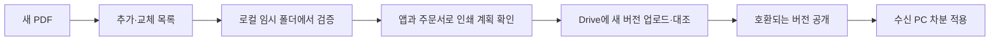

# 빠른 인쇄기 전체 검토와 구현 계획

2026-11-20 · 검토 기준 커밋 `4f9e291` · Windows / Python 3.12 / Tkinter

**운영자에게 가장 큰 개선은 주문서의 등록 범위를 즉시 알 수 있게 하는 것과, 자주 쓰는 자료를 다시 찾는 단계를 줄이는 것이다. 배포 담당자에게 가장 시급한 개선은 어느 설치본에 어느 자료를 적용할 수 있는지 기계가 판정하게 하는 것이다.** 아래 작업은 다음 구현 세션의 계획이다. 이번 검토에서는 현재 프로그램을 기준점으로 보존하고 설치 안내를 바로잡았다.

## 무엇을 확인했나

| 영역 | 관측과 근거 | 판단 |
|---|---|---|
| 실제 등록 | 11월 1~20일 로컬 이력의 `block_added` 1,466건 중 주문번호 있음 1,208건(82.4%). 주문번호 없는 258건 중 직접 PDF 97건, APEX 61건, 교과서 핵심문제 변형 31건 | 주문번호는 주문서 계열의 지표다. 복제·복원도 같은 번호를 가질 수 있다. CSV 수나 고유 사용자 수로 해석하지 않는다. |
| 주문서 | `add_order_csv_blocks`는 화면에서 선택한 행과 관계없이 `result.rows` 전체를 검증한다. `commit_order_csv_blocks`는 이름순으로 안정 정렬하고 한 번의 실행 취소로 등록한다. 정상 CSV에서 버튼 문구는 ‘주문서 블록 추가’다. | 행 선택과 등록 범위를 혼동할 여지가 있다. 기존 전체 등록과 가나다순을 유지하면서 대상 수를 버튼에서 알려준다. |
| 수동 등록·설계 | 시험지와 단원평가는 각각 자료·범위 검증 후 부수와 개별 번호, 이름 초기화, 실행 취소, 큐 갱신, 미리보기를 처리한다. 자료 준비가 늦을 때는 등록 요청 순서를 보존한다. 직접 PDF는 여러 파일 드롭을 지원한다. | 목록을 다시 훑는 횟수와 포커스 왕복을 줄인다. 기존 단축키와 비동기 등록 순서를 활용한다. |
| 시작 확인 | `PrintExecutionMixin.prepare_print_request`에서 일반 인쇄·재시도 준비 작업자가 자원 예측을 최대 15초 기다릴 수 있다. 큐 내용 전체를 담은 `_print_preparation_queue_key` 및 현재 선택을 확인창 전후로 비교한다. 선택 인쇄는 전체 큐 예측을 건너뛴다. | 예측이 늦으면 확인창이 늦을 수 있다. GUI 전체가 15초 멎었다는 측정은 없다. 자료 검증·프린터 검증 소요와 예측 대기를 따로 잰다. |
| 구조 | Python AST 기준 `unit_print_manager.py` 15,015줄, `PrintManagerApp` 직접 메서드 525개. `build_ui_reset` 810줄. `print_blocks_device_rolling` 612줄 안에 장비 대조, ETA, 보류, 재개, 전송과 이력이 함께 있다. | 첫 분리 단위는 같은 등록 후처리를 반복하는 함수와 별도 검증이 가능한 계산이다. 장비 전송 루프는 마지막에 다룬다. |
| 자료 식별 | 일산은 폴더·파일명을 스캔하고, 서버 자료 ID는 상대경로가 같을 때 안정적이다. A:ble은 차시·합본·리뷰 규칙이 있고, 교과서는 검증된 페이지 구간을 별도로 보관한다. 배포 수집은 자료군별 함수를 다시 호출한다. | 같은 PDF가 UI, 주문서, 배포에서 서로 어떻게 보이는지 한 등록 작업에서 검사해야 한다. 폴더명 변경도 ID 변경 후보로 표시한다. |
| 설치본과 Drive | r2의 PDF 목록은 1,891개, 11월 20일 증분 목록은 1,730개다. 경로를 정규화해 대조하면 r2에만 214개, 증분에만 53개, 양쪽에 있으나 해시가 다른 경로가 3개다. 증분에서 원본 설치가 필수인 항목 6개가 r2에서 없거나 해시가 다르다. | 목록 개수 차이는 삭제 목록이 아니다. 현행 pull은 원본 불일치 시 멈춘다. r2에 최신 자료를 적용하려면 호환 경로를 먼저 만들어야 한다. |
| 버전 복구 | `command_publish`는 변경 PDF를 동일한 `overlay/<상대경로>`에 올린 뒤 `history/<version>.json`과 최신 목록을 올린다. `command_pull`은 전부 내려받아 SHA-256을 검사한 후 파일마다 `os.replace`하고 마지막에 상태를 기록한다. | 과거 목록이 있어도 같은 경로의 과거 바이트를 내려받을 수 있다는 보장이 없다. 적용 도중 프로세스가 종료되면 새 파일과 이전 파일이 섞일 수 있다. |
| 운영·공개 범위 | 빌더가 앱 파일을 명시적으로 수집하고 글꼴을 검증한다. 한편 선택 인자로 받은 부서 ID/PIN을 문서에 치환할 수 있고, 참고 화면 디렉터리는 통째로 복사한다. r2 추출본의 해당 문서 2개는 ‘수신 PC에서 사용자가 직접 입력’ 기본값으로 생성한 내용과 일치했다. | 이번 r2에서 인증정보 노출은 확인되지 않았다. 다음 배포에서는 민감한 인자를 받는 경로와 미검토 이미지가 들어갈 여지를 없앤다. |

배포 비교에는 r2 추출본의 `release_manifest.json`과 11월 20일자의 `latest_assets.json`을 사용했다. Drive에서 r2 전달 파일 70개의 이름·크기·MD5가 당시 검증 목록과 일치했고, 원격 최신 목록 파일의 MD5도 로컬 사본과 일치했다. 이번 대조는 원격 PDF 전체를 재다운로드한 검사가 아니다. 기존 README가 10월 7일판 병합 방법을 가리키던 문제는 이번에 수정했다.

현행 배포 수집기 `collect_registered_pdfs`로 얻은 **로컬 등록 PDF 1,938개 전체**의 SHA-256도 계산했다. r2의 1,891개 경로가 모두 포함되며 47개가 추가됐다. 공통 경로 중 내용이 바뀐 3개는 A:ble이고 변경본은 모두 증분 목록과 일치했다. 반면 **일산기출 미적1 기말 중상 「1회차 25 저동고」**는 로컬 4,262,507바이트, Drive 4,258,127바이트였다. 원격 PDF를 직접 받아 SHA-256이 증분 목록과 일치함을 확인했다. 양쪽 모두 8쪽이지만, 전체 페이지를 144dpi로 렌더링해 비교하니 **7쪽에서만 픽셀이 달랐다**. 어느 판을 배포할지는 7쪽 원고를 확인한 후 결정한다. 검토 중 양쪽 파일을 그대로 보존했다.

## ETA는 어디서 틀리나

11월 1~20일 `run_finished`에서 장비 완료가 확인되고 초기 예측 오차가 기록된 실행은 63회였다. 세션 ID와 실행 ID로 묶고, 처음 예상한 작업 수가 실제 완료 수와 같으며 보류·추가·예약 삭제·취소 요청이 기록되지 않은 57회를 비교했다. 작업 수에는 이름 구분지와 OMR 같은 별도 전송도 포함된다.

| 전송 작업 수 | 실행 수 | 초기 예측의 절대오차 중앙값 | 절대오차 90백분위 |
|---|---:|---:|---:|
| 1~49건 | 39 | 17초 | 47초 |
| 50건 이상 | 18 | 2분 4초 | 7분 39초 |

90백분위는 절대오차를 정렬해 올림 순위로 계산했다. 큰 작업에서 실제 완료가 예측보다 늦은 정도의 중앙값은 **1분 21초**였다. 가장 큰 오차는 89건 실행에서 **21분**이었다. 이 실행에서 연속 전송 기록 사이에 **19분 15초**, 연속 실물 완료 관측 사이에 **19분 20초**의 공백이 있었다. 공백의 원인은 현재 이력만으로 확정할 수 없다. 이 숫자는 실행 중 첫 예측과 장비 완료를 앱이 확인한 시각의 차이다. 큐를 만들 때 보던 상단 예측, 마지막 종이가 트레이에 떨어진 시각과는 각각 다를 수 있다.

현재 `unit_print_eta`는 짧은 작업·긴 작업·여러 부를 구분한다. 장비·양면·유사 크기를 고려하며 실제 진행 중인 작업에서만 경과 시간을 뺀다. 화면 새로고침 때마다 종료 시각을 뒤로 미루지 않는다. 전체 속도 상수를 일괄 조정하면 이미 오차가 작은 짧은 인쇄까지 흔들 수 있다.

## 구현 순서와 완료 조건

### 1. 두 배포 기준을 대조하고 로컬 적용 가능 여부를 먼저 표시한다

**첫 PR은 읽기 전용으로 끝낸다.** `scripts/quick_printer_asset_sync.py`의 매니페스트 로더·경로 정규화·해시 함수를 재사용한다. `status`와 `plan-update` 명령을 추가해 설치된 코드 커밋 또는 릴리스 ID, 기준본 해시, 적용된 자료 버전, 카탈로그 스키마, 목표 버전, 필요한 파일 수·바이트·불일치 이유를 출력한다. 출시 시점의 Git 태그는 이번 점검 기준 0개다. 첫 정식 버전에 태그를 부여하고 검증한 커밋을 고정한다.

- 현재 r2 목록, v1 최신 목록, 실제 등록 수집 결과를 **세 방향**으로 비교한다. r2에만 있는 교과서 141개·학군지 39개·일산 34개를 각각 추적한다. 같은 경로의 내용 교체는 새로운 SHA-256과 과목 규칙으로 승인한다. 빠진 자료를 단순 삭제하거나 두 목록을 기계적으로 합치지 않는다.
- UI의 `select_configured_root`와 배포 수집기의 `collect_unit_sources`가 같은 루트를 사용하게 한다. 후자는 저장된 `root_dir`를 직접 우선한다. 현재 PC의 단원평가 수집 경로는 모두 선택된 자료 루트 아래였다. 옛 D 드라이브 경로가 설정에 남은 PC와 C 드라이브만 있는 PC를 별도로 시험한다.
- 배포 기술 명세에는 `app_commit`, `catalog_schema`, `asset_version`, `baseline_digest`, `asset_set_sha256`, 지원하는 이전 기준과 변경 파일을 둔다. Git이 관리하는 공개 정보에는 설치판의 식별자와 검증용 해시만 둔다. PDF와 비공개 채널 설정은 기존 Drive 구조에서 관리한다.
- r2, 기존 v1 설치, Git 소스+외부 자료 폴더, 기준 불명, 로컬 수정본을 시험한다. 각 경우에 ‘적용 가능 / 기준본 복구 필요 / 로컬 변경 충돌’과 이유가 같게 나오는지 검사한다. 예상한 설치 루트와 실제 `release_root`도 보여 준다.
- **완료 조건**은 두 정상 기준에서 같은 승인 목록에 도달하는 차분을 만들고, 불일치 6개 각각에 검증 가능한 복구 원본을 지정하는 것이다. 미확정 항목이 있으면 해당 기준의 배포 공개를 보류한다.

### 2. 가장 많이 쓰는 등록 동선을 먼저 줄인다

첫 화면은 기존 Tk/ttk 구성과 62px 큐 행을 유지한다. 단축키를 새로 외우게 하는 것보다 **다음에 적용될 작업과 범위가 기존 버튼에서 보이게 하는 것**을 우선한다.

| 시나리오 | 구현 지점과 제안 | 인수 조건 |
|---|---|---|
| 주문서 100행 등록 | 주문서 미리보기와 기존 추가 버튼에 ‘전체 100행 추가’ 표시. 오류가 있으면 최초 오류 행·필드로 이동한다. 등록 성공 시 상태 줄에 추가 수와 실행 취소 방법 표시. `resolve_order_csv_blocks`의 등록 ID 인덱스는 동일 카탈로그 판에서만 재사용한다. | 한 행을 선택해도 버튼의 수와 실제 전체 추가 수가 일치한다. 오류 1행이면 추가 0건이다. 같은 이름의 상대 순서와 기존 큐 순서를 보존한다. |
| 직접 PDF 연속 추가 | 기존 다중 드롭·파일 선택·부수 입력을 사용한다. 선택한 파일 수와 등록될 블록 수를 버튼 옆 기존 요약에서 구분한다. 등록 성공 후 다음 자료를 고를 수 있는 입력으로 키보드 포커스를 복귀한다. | 파일명에 한글·공백, 같은 이름의 다른 경로, 여러 파일과 여러 부를 포함해 검증한다. 드롭·키보드 동선으로 같은 결과가 나와야 한다. |
| APEX·단원평가 반복 | 기존 폼에 ‘최근 자료’ 선택을 작게 배치한다. 과목·자료군·차시/범위만 세션에서 재사용한다. 이름·주문번호·부수는 자동 상속하지 않는다. 카탈로그가 바뀌면 다시 검증한다. 먼저 APEX 하나에 시범 적용해 효과가 있으면 확대한다. | 최근 자료를 선택하고 차시만 바꿔 기존 `Ctrl+Enter`로 등록한다. 오래된 항목, 한글 조합 중 Enter, 비동기 준비 중 다른 폼 수정에도 오등록·중복 추가가 0건이다. |
| 선택 인쇄·보류 | 기존 동작 메뉴에서 ‘선택 N개 인쇄’와 비활성 사유를 노출한다. 보류 시 ‘사유 → 지금 할 일 → 정상 확인 후 자동 재개’를 같은 위치에 표시한다. Canon 연결 시 장비 내부 창과 Windows 묶음/재충전의 실제 적용 범위를 구분한다. | 전체와 선택 인쇄를 혼동하지 않는다. 다중 선택, 키보드 메뉴, 인쇄 직전 선점, 부분 인쇄에 다른 블록 추가 금지, 작업표시줄과 팝업의 상태 일치를 검사한다. |

먼저 대표 작업 3개를 같은 카탈로그와 큐로 각각 5회 기록한다. 새 자료 최초 등록과 같은 자료 재등록을 분리한다. 입력 횟수, 클릭, 포커스 이동, 잘못 추가한 블록 수, 요청부터 등록을 눈으로 확인할 때까지 시간을 잰다. 시범 목표는 반복 등록 중앙시간 25% 또는 필수 조작 2회 이상 감소, 오등록 0건이다. 100/125/150% 배율에서 긴 파일명, 키보드 포커스, 진행·완료 배지를 확인한다. 색에 더해 상태 단어를 유지한다. 기존 파랑·초록·주황·빨강의 의미를 보존한다.

### 3. 새 자료 등록과 Drive 발행을 한 절차로 만든다

자료를 발견한 시점과 배포를 공개한 시점을 구분한다. 실패한 임시 파일은 현재 사용자가 보는 목록에 진입하지 않는다.

1. 발행자용 `plan-import`를 만든다. 입력은 자료군, 원본 파일/폴더, 목적 자료 루트다. 기존 `scan_test_catalog`, `scan_able_catalog`, 교과서 페이지 검증기와 `quick_printer_safe_assets`를 이용한다. 결과에 상대경로·기존/신규 해시·페이지 수·정규 자료 ID·서버 별칭·추가/교체/변경 없음/충돌을 담는다. 파일명만으로 과목이나 단원을 확정할 수 없으면 해당 행을 보류한다.
2. 첫 사례는 ‘일산 같은 회차·다른 난이도’와 ‘A:ble 차시/합본/백지리뷰’로 한다. A:ble은 차시별·풀세트의 파일 순서와 페이지 범위, 일산은 과목·시험·난이도·회차와 기존 CSV 별칭을 시험한다. 교과서는 판본 서명·표지·단원 평가 포함·해설 범위를 현재 검증기로 검사한 뒤 같은 도구에 편입한다.
3. 원본 해시가 계획 이후 달라지면 중지한다. 실제 앱의 블록 생성과 `build_print_jobs`를 임시 자료 루트에서 실행한다. 앱에 보이는 신규 항목과 배포 수집 결과를 대조하고 서버 주문 대상은 기존 ID로도 해석되는지 검사한다.
4. 새 버전의 PDF를 내용 해시별 불변 위치에 올리고 대조한 뒤 버전 목록을 저장한다. 기존 배포 폴더와 동기화 바로가기는 유지한다. 바뀌는 최신 포인터는 마지막에 갱신한다. 발행자는 한 번에 하나로 직렬화하고, 시작 시 읽은 원격 버전이 달라지면 공개를 중단한다. CLI와 Codex 지시서는 같은 명령을 호출한다.
5. 가짜 Drive와 별도 시험 폴더에서 동일 배치 두 번, 동일 경로 교체, 업로드 중단, 원격 목록 갱신 충돌을 검증한다. 두 번째 실행은 추가 업로드 0개여야 한다. 성공 기록에는 적용 버전과 파일별 검증 결과를 남긴다. 기존 자료를 되돌릴 때 쓸 바이트도 확보한다.

### 4. 수신 PC가 자기 버전에 맞는 패치만 적용한다

- 설치 방식은 두 종류다. Git 작업 폴더는 깨끗하고 지정 커밋까지 fast-forward 가능한 경우에만 코드 갱신을 제안한다. 개인 수정이나 갈라진 브랜치가 있으면 별도 폴더에 시험판을 설치한다. ZIP 설치는 코드와 의존성을 버전별 디렉터리에 준비한다. 공통으로 실행 시점의 코드와 자료 조합을 기록한다.
- 일반 사용자의 명령은 ‘업데이트 확인 → 적용’ 두 단계로 한다. 실제 다운로드는 변경 객체만 받는다. 디스크 여유와 파일 잠금, 자료 루트가 다른 드라이브인 경우를 먼저 점검한다. 현재 앱이 인쇄하거나 큐를 편집 중이면 패치가 강제로 종료시키지 않는다.
- 기존 설치는 한 차례 현재 판의 목록·해시와 설정 위치를 등록한다. 확인된 원본만 관리 대상으로 삼는다. 새 파일은 목적 볼륨에 준비하고 모두 검증한다. 코드와 자료가 함께 준비되면 공통 런처가 읽는 **활성 버전 파일 하나**를 원자 교체한다. 자료가 큰 경우 같은 볼륨에서 검증된 불변 파일 재사용을 시험하고 링크를 지원하지 않는 위치에서는 공간을 계산해 복사한다. 변경된 파일을 기존 링크 위에 덮어쓰면 이전 판까지 바뀌므로 새 파일로 생성한다.
- 설정·인쇄 이력·복구 영수증·로컬 자료 경로는 현재 위치를 명시적으로 이관하거나 공용 사용자 상태 경로에 연결한다. Windows 자격 증명과 단일 인스턴스 잠금도 확인한다. 실행 중인 앱과 업데이트 프로세스가 동일한 배타 조건을 사용해야 한다. 기존 원샷 설치와 글꼴 검증을 살린다.
- 호환되는 앱·카탈로그·자료 세트를 함께 되돌린다. 첫 실행이 실패하면 직전 정상 조합으로 복귀한다. 재실행으로 인쇄 작업을 시작하지 않는다. 과거 복구 큐의 소스가 교체되었으면 안전하게 판별할 수 있는 범위만 복구하고 나머지는 검토 대상으로 남긴다.
- **합격 시나리오**는 r2→새 판, v1→새 판, 이미 최신, 오프라인 재실행, 파일 하나 손상, 파일 잠금, 디스크 부족, 공개 전후 및 활성화 전후 강제 중단, 개인 Git 수정 보존이다. 각 경우에 이전 판 또는 다음 판 하나만 실행되고 원본 PDF·설정·인쇄 이력은 보존돼야 한다.

### 5. ETA를 실측과 비교한 뒤 큰 작업부터 개선한다

1. 읽기 전용 평가 명령을 만든다. `run_started`, `job_submitted`, `job_physically_completed`, `device_dispatch_held`, `device_dispatch_resumed`, `run_finished`를 세션·실행별로 조합한다. 보고서에는 건수·장수·경과 시간·오차만 남긴다. 초기 화면 예측, 실제 시작, 진행 25/50/75% 예측에 같은 작업 집합 식별자를 붙인다. 현재 이력에 없는 예측은 ‘미관측’으로 둔다.
2. 장비 완료 시각과 앱이 확인한 시각을 나눠 평가한다. 보류·타 앱 선점·작업 추가·삭제·관측 공백을 구분한다. 원인을 모르는 공백은 따로 집계한다. 사용자에게 경험된 전체 오차 통계에는 포함하고 엔진 속도를 학습할 때는 제외한다.
3. 기존 `estimate_workloads_seconds`를 기준 모델로 고정한다. 이름 구분지·OMR 같은 짧은 작업과 본문, 여러 부, 확인 지연을 분리한 후보 하나를 비교한다. 같은 실행에서 미래의 완료 정보를 학습에 넣지 않는다. 장비별 시간순으로 이전 실행만 이용한다. 표본이 적은 유형은 기존 추정치로 돌아간다.
4. 시범 합격 기준은 시간순 검증에서 긴 실행의 절대오차 90백분위 20% 이상 감소, 짧은 실행 중앙값 악화 5초 이내다. 큰 작업 18회에서는 꼬리값이 불안정하므로 평가 구간 수와 최악 사례를 함께 보고하고 추가 운영 표본으로 재확인한다. 개선이 없으면 진단·표시 개선만 채택한다.
5. 평소에는 ‘예상 완료 오후 2:15’를 유지한다. 근거가 적거나 상태 확인이 끊기면 ‘초기 추정’ 또는 ‘프린터 상태 확인 중’과 마지막 관측 시각을 표시한다. 구간과 근거는 기존 상세 보기에 둔다. 시간 경과만으로 인쇄 완료를 표시하지 않는다.

### 6. 구조·테스트·Git 배포 절차를 정리한다

| 순서 | 변경 단위 | 회귀 확인 |
|---|---|---|
| A | `add_current_block`과 `add_test_catalog_block`의 등록 후처리를 한 함수로 모은다. 입력 검증·자료별 조립은 원래 함수에 둔다. 주문서의 다건 원자 등록은 별도로 유지한다. | 늦게 완료된 자료도 입력 순서를 보존한다. 도중에 바꾼 이름·부수를 지우지 않는다. Undo 1번에 논리적 등록 1건만 취소된다. |
| B | 확인창의 예측 대기를 PDF/프린터 필수 검사와 분리한다. 느린 예측은 같은 요청의 결과만 갱신한다. 전체·선택·미전송 재시도의 확인 문구와 예측 대상도 일치시킨다. | 15초 지연 가짜 예측에서 필수 검사 완료 후 확인 가능. 확인창 도중 큐·프린터가 바뀌면 오래된 준비 결과 폐기. 미완료 예측을 용지 충분으로 표현하지 않는다. |
| C | 장비 관측을 입력으로 받아 보류·재개·완료·미확인을 판정하는 부분부터 `unit_print_dispatch_state` 쪽으로 추출한다. Tk 갱신, 장비 IO, 이력 기록은 실행 계층에 남긴다. | 동일한 관측열에서 기존과 동일한 전송 순서·횟수. 장비 복구 직후 토큰 누락, 전송 직후 이력 실패, 실물 완료와 Windows 큐 비움, 파일 이동 후 재시도를 포함한다. |
| D | GUI 종료 시 등록한 타이머를 소유 위젯에서 해제하고 모의 앱과 실제 종료 경로를 구분한다. `on_close`의 설정 저장 예외로 `is_closing=True`인 창이 남을 수 있는 경로도 검사한다. | 조용한 종료·오류 종료·복구 저장 중 종료를 반복한다. 콜백 예외 및 Tcl stderr까지 검사하고, 실패 시 큐 보존 또는 다시 조작 가능한 창을 확인한다. |
| E | 배포 빌더·부트스트랩의 파일 목록 일치 검사에 깨끗한 체크아웃 설치와 업그레이드 검사를 더한다. 새 모듈을 추출할 때마다 수집 목록을 같은 커밋에 반영한다. | Windows/Python 3.12에서 가상 PDF와 모의 프린터로 실행. 전체 자료 검증은 승인된 발행 환경에서 실시. 공개 CI에는 운영 자료나 인증값이 없어야 한다. |

일반 배포 빌더에서 자격 증명값 전달을 제거하고 수신 PC 직접 입력으로 고정한다. 참고 화면은 합성 자료로 만든 검토된 파일만 수집한다. 릴리스 태그에는 테스트한 코드 커밋을 연결하고, 코드 호환표·설치 결과·이전 정상 버전을 기록한다. 공개 Git에는 코드·카탈로그·비식별 테스트·허용된 문서만 올린다. 앱을 여는 첫 화면에 파일 해싱을 추가하지 않는다.

## 검증 결과와 다음 세션의 시작점

- 앱 회귀 테스트 1,007개 통과. 테스트 종료 시 Tcl에서 이미 파괴된 창의 `poll_queue_recovery_save` 등 콜백 경고가 나왔다. 정상 종료에서도 발생하는지는 별도 확인 대상이다.
- 서버 연동 검사는 등록 시험 자료 1,611개, 중복 ID 0개, 누락 경로 0개였다. 대표 주문 3행, 일산 서버 별칭 34종, 이름 구분지와 OMR 규칙이 통과했다. 숫자 1,611은 서버 연동 시험지 범위다.
- 숨김 Tk 벤치마크 원본 명령은 종료 중 `can't delete Tcl command`로 실패했다. 진단 프로세스 안에서 타이머 1개를 소유 위젯에서 취소하도록 바꾸자 같은 시나리오가 끝났다. 100/1,000블록에서 단일 선택·카탈로그 폼 콜백 중앙값은 약 5.5~7.4ms였다(각 5회). 벤치마크가 같은 행을 반복 선택하므로 새 자료를 찾고 등록하는 시간은 별도로 측정해야 한다. 이번에 실물 인쇄·사람의 조작 시간·수신 PC 설치는 시험하지 않았다.
- 로컬 재현은 `.venv\Scripts\python.exe -m unittest discover -s tests -p "test_unit_print*.py"`와 `.venv\Scripts\python.exe scripts/verify_quick_printer_server_integration.py`로 시작한다. 응답성은 `scripts/benchmark_quick_printer_responsiveness.py`의 `--only-operations selection_single catalog_form --include-extra-interactions --settle-between-repeats`를 이용한다. 종료 오류를 고친 뒤 포커스를 서로 다른 행으로 교대하고 사람의 동선도 따로 기록한다.

**6.2 Sol 구현 인계** — 첫 커밋은 1단계의 읽기 전용 호환 판정과 합성 r2/v1 회귀 사례로 제한한다. 두 번째 커밋은 2단계 주문서 버튼·오류 행 이동과 기존 전체 등록 회귀 검사다. 이후 3→4단계를 시험 채널에서 연결한다. ETA 평가와 GUI 종료 오류 재현은 독립 작업으로 진행할 수 있다. 각 변경을 분리해 검증한 뒤 단계별로 합친다. 운영 Drive 공개, 실제 프린터 시험 및 전체 설치본 교체는 각각 검증 결과가 준비된 시점에 수행한다.
