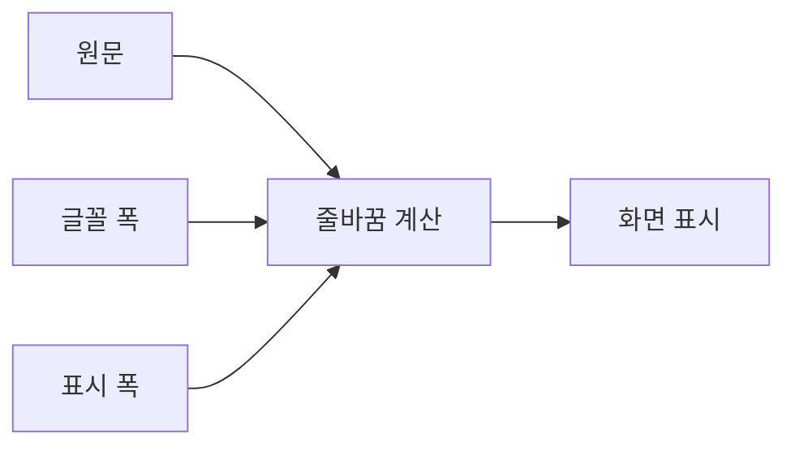

# 빠른 인쇄기 GUI 디자인 참고와 라이선스

2026-10-07. 첫 적용 화면은 `테스트 > 단원평가`와 오른쪽 작업 큐가 있는 기본 작업 화면이다. 공통 스타일을 사용하는 기존 입력칸·버튼·상태 표시에도 같은 토큰이 적용된다. 다른 탭의 구조를 새로 설계하지 않는다.

## 기존 환경과 변경 범위

- Python 3.12, Tkinter/ttk, ttkbootstrap 2.2.3의 기존 테마를 유지한다. tkinterdnd2 0.6.3의 파일 드롭 기능도 그대로 둔다.
- `unit_print_theme.py`에서 의미별 색상과 기존 ttk 스타일의 글자·간격·테두리·상태 규칙을 관리한다. Tk 상태 배지와 Canvas 작업 큐는 같은 색상 사전을 사용한다.
- 2026-10-07 사용자가 Aurora Frame을 취소했다. 이전의 흰 상단·패널, 옅은 회색 본문, 파란색 동작·선택·포커스로 복원한다. 이후 정상 상태 통일 요청에 따라 빨강=오류·경고, 주황=큐 예약·대기 작업, 초록=진행·전송 중, 파랑=정상 대기·인쇄 가능·완료로 정리한다. 완료 배지의 `전송 완료`와 `인쇄 완료` 문구는 기존 판정에 따라 구별한다. 상태 문구를 유지해 색상에만 의존하지 않는다.
- 기본·hover·pressed·focus·disabled·처리 중 표시를 구분한다. 비활성 상태가 hover보다 우선한다. `인쇄 시작` 버튼은 기존 실행 상태에서 `인쇄 중` 문구와 별도 색상을 사용하며 같은 명령을 유지한다.
- 입력칸 글꼴과 여백을 통일한다. 설치된 기존 한글 글꼴을 유지한다. 이름 입력이 활성화된 정상 상태를 오류처럼 붉게 표현하지 않는다.
- 큐 카드의 모서리는 6px다. 카드 높이 62px, 간격 8px, 스크롤·드래그 좌표는 유지한다. 본문은 한 줄로 표시하고 긴 내용은 생략한다. 부수·상태·순번은 오른쪽에 작게 표시한다. 시안의 두 줄 카드 높이를 실제 앱에 적용하지 않는다. 기존 단축키·선택·복사·정렬·작업기·API·데이터·CSV·PDF·설정 형식을 유지한다.
- 큐 이름은 파랑 굵게, 서브탭·과목은 검정 굵게, 그 뒤 범위·부수 등의 정보는 기존 일반 글꼴로 표시한다. `[일반]` 표시는 생략하고 `[묶음]`은 유지한다. 예: `[한동훈] / 단원평가 / 공통수학1 / Lv.3 / 1회차 / 01.~`. 글꼴별 실제 폭을 측정해 오른쪽 부수·상태·순번과 겹치지 않게 자른다.
- Aurora 전용 어두운 프레임·장식·상단 완료 시각 표시를 제거한다. 예상 완료 시각과 갱신 기능은 기존 옵션 바의 자원 예측에서 유지한다.
- 장식용 애니메이션, 배경 패턴, 새로운 아이콘 라이브러리, 웹 프레임워크를 추가하지 않는다. 기존 드래그 동작과 앱 아이콘을 유지한다.

## 검토한 소스

| 소스 | 사용 판단 | 라이선스와 원본 고지 |
|---|---|---|
| [shadcn/ui](https://github.com/shadcn-ui/ui) | 기본/보조/위험 버튼 구분과 의미별 테마 토큰 구조를 참고한다. React 컴포넌트는 설치하거나 복사하지 않는다. | [MIT](https://github.com/shadcn-ui/ui/blob/main/LICENSE.md), Copyright (c) 2023 shadcn. |
| [tweakcn](https://github.com/jnsahaj/tweakcn) | [Modern Minimal 테마](https://github.com/jnsahaj/tweakcn/blob/main/utils/theme-presets.ts)의 흰 표면·회색 보조 면·파란 강조 방향을 참고한다. 실제 색상은 대비를 위해 별도로 조정한다. 프리셋 소스를 복사하지 않는다. | [Apache License 2.0](https://github.com/jnsahaj/tweakcn/blob/main/LICENSE). |
| [Uiverse Galaxy](https://github.com/uiverse-io/galaxy) | 단순 테두리와 상태 구분 방식을 검토했다. 개별 HTML/CSS 요소는 Tkinter와 직접 호환되지 않아 가져오지 않는다. | [MIT](https://github.com/uiverse-io/galaxy/blob/main/LICENSE), Copyright (c) 2023 Uiverse.io. 개별 요소를 복사할 경우 해당 제작자의 고지도 보존해야 한다. |
| [Pattern Craft](https://github.com/megh-bari/pattern-craft) | 배경 예제를 검토했다. 업무 화면의 밀도와 본문 가독성을 위해 단색 바탕을 선택한다. 패턴 코드·이미지는 사용하지 않는다. | [MIT](https://github.com/megh-bari/pattern-craft/blob/main/LICENSE), Copyright (c) 2025 Megh Bari. |
| [Lucide](https://github.com/lucide-icons/lucide) | 일관된 선 아이콘 방향을 검토했다. 이번 화면에는 새로운 아이콘을 추가할 필요가 없어 기존 표기를 유지한다. | [ISC 및 Feather 유래 아이콘의 MIT 고지를 포함한 전체 LICENSE](https://github.com/lucide-icons/lucide/blob/main/LICENSE). 아이콘을 실제 도입할 때 전체 고지를 함께 배포해야 한다. |

참고 문서: [shadcn 테마](https://ui.shadcn.com/docs/theming), [shadcn 버튼](https://ui.shadcn.com/docs/components/base/button), [Python ttk 스타일](https://docs.python.org/3/library/tkinter.ttk.html#styling).

이번 변경은 위 저장소의 코드·아이콘·폰트·이미지 자산을 배포하지 않는 자체 Tkinter 스타일 구현이다. 별도로 Pretendard v1.3.9의 Regular/Bold/Medium/SemiBold TTF를 정본에 포함한다. 제작 PC 파일과 공식 `static/alternative` 파일의 SHA-256이 일치한다. SIL Open Font License 1.1 원문은 `fonts/Pretendard/LICENSE.txt`, 출처·해시는 `fonts/quick_printer_fonts.json`, 설치 절차는 `fonts/README.md`에 보존한다. Microsoft·윤고딕 글꼴 파일은 포함하지 않는다. 위 라이선스 표를 다른 원본 자산의 라이선스 변경이나 재배포 허가로 해석해서는 안 된다.

## 확인 범위

기존 실제 Tk 생성자 검사에서 임시 설정·이력·복구 폴더를 사용한다. 프린터, Canon 로그인, Windows 알림, IME 네이티브 호출은 차단한다. 실제 ttk 상태 조회로 disabled+hover 우선순위, 키보드 포커스, 읽기 전용 선택칸, 처리 중 버튼과 원래 명령 유지를 확인한다. 큐 렌더링·키보드·텍스트 편집 회귀 검사는 별도로 수행한다.

네이티브 화면 제어가 제한된 환경에서는 `ImageGrab` 등 외부 캡처 도구로 우회하지 않는다. 숨긴 Tk 창의 검사 결과를 실제 스크린샷 또는 수동 시각 검토 완료라고 표현하지 않는다. 모든 화면 크기·배율에서 잘림이 없다는 주장은 실제 화면 검토가 추가로 필요하다.

## 한국어 줄바꿈 (2026-10-09)

사용자가 전달한 [한국어 줄바꿈 안내](https://www.threads.com/@ddal_kkak_/post/DeLA4z6E3jC)의 원칙을 기존 Tkinter 화면에 적용한다. 게시글의 본문과 캡처를 사용자에게 받아 확인했다. CSS나 웹 프레임워크를 추가하지 않는다. `unit_print_typography.py`는 자체 구현이며 참고 글의 코드를 복사하지 않는다.

| 원칙 | 실제 적용 |
|---|---|
| `word-break: keep-all` | 픽셀 폭을 측정해 어절이 들어가면 한 덩어리로 유지한다. |
| `overflow-wrap: break-word` | 한 어절이 전체 폭보다 길 때만 나눈다. 한글 조합·악센트·이어진 이모지는 한 글자 묶음으로 유지한다. |
| `text-wrap: balance` | 팝업·마우스 도움말의 짧은 제목을 기존 줄 수 안에서 고르게 배치한다. 최대 여섯 줄, 80어절까지만 계산한다. |
| `text-wrap: pretty` | 자료·주문서·복구 안내와 팝업 본문에서 끝줄의 한 어절을 완화한다. 앞줄·끝줄이 모두 폭 안에 들어갈 때만 이동한다. |
| `white-space: pre-line` | 안내문의 원래 줄바꿈과 빈 줄을 유지한다. 연속 가로 공백은 화면 표시에서만 정리한다. |
| `nowrap` / 원문 유지 | 버튼·상태 배지·큐 제목은 기존 표시 규칙을 유지한다. 입력칸·로그·미리보기·행별 단축키 안내의 원문은 바꾸지 않는다. |

원문 변수에는 새 줄바꿈을 쓰지 않는다. 표시용 변수만 갱신하므로 인쇄·CSV·파일 경로·알림 판단은 기존 값을 사용한다. 반복 갱신과 창 크기 변경은 idle 콜백 하나로 모으고, 같은 값·폭·글꼴이면 다시 계산하지 않는다. 팝업을 닫을 때 변수 추적과 크기 변경 콜백을 제거한다. 내용에 맞춰 크기가 정해지는 마우스 도움말은 부모 폭을 다시 좁히는 계산을 끈다.

배포 수집기와 시작 검사에 새 모듈을 포함한다. 이번 작업은 로컬 패치이며 이전 배포 ZIP을 다시 만들거나 Drive 파일을 갱신하지 않는다. 참고 문서: [Tk label](https://www.tcl-lang.org/man/tcl8.6.14/TkCmd/label.htm), [CSS text-wrap-style](https://developer.mozilla.org/en-US/docs/Web/CSS/Reference/Properties/text-wrap-style). Tk의 동작을 CSS 브라우저 구현과 픽셀까지 동일하다고 주장하지 않는다.
